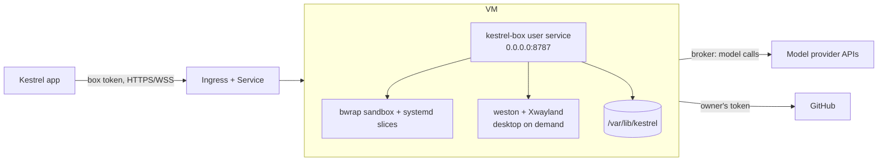

# Per-user boxes on KubeVirt (MVP)

Status: MVP. This is the compute layer for the Nest: one KubeVirt VM per box owner, running the existing
`packages/server` box. It does not change the box contract or the control plane.

## What it creates

`scripts/nest-vm.ts create` renders and optionally applies:

| Resource | Purpose |
|---|---|
| `Namespace` | `kestrel-nest` by default |
| `NetworkPolicy` | Only the ingress controller may reach the box port; egress is open for model APIs, GitHub and package installs |
| `Secret` | cloud-init userdata, including the box id and secret |
| `VirtualMachine` | 4 vCPU / 8 GiB by default, with an OS disk and a data disk |
| `Service` | port 8787, selecting the virt-launcher pod |
| `Ingress` | TLS at `--host`, with `/mcp`, `/broker` and `/gh` blocked |

The OS disk is a CDI `DataVolume` pulled from `quay.io/containerdisks/ubuntu:26.04`. The data disk is a blank
`DataVolume` mounted at `/var/lib/kestrel`; it holds threads, workspaces, mirrors and CLI logins. Both survive VM stops
and restarts.

## How it works



1. CDI boots Ubuntu from the container disk and cloud-init runs once.
2. cloud-init installs bubblewrap, git, Node, the agent CLIs, weston/Xwayland, ffmpeg and the X11 capture headers.
3. It downloads the `kestrel-box` release binary, writes the box config under `/home/kestrel`, and runs
   `kestrel-box install` as the `kestrel` user. That builds `xdamage-capture`, writes the user systemd unit and enables
   linger, so the box starts at boot and keeps per-thread systemd slices.
4. A drop-in sets `CLOUDAGENTS_HOST=0.0.0.0`; for `--managed` it also sets `CLOUDAGENTS_BOX_MANAGED=1`.
5. The Ingress routes the public box URL to the Service. The box still verifies box tokens offline, and the agent still
   reaches models through the broker, so no model key enters the VM's environment.
6. The desktop is unchanged: a headless weston with a rootful Xwayland inside the VM, captured and encoded there, and
   streamed to the viewer. There is no physical display in any deployment, including a bare-metal box.

## Prerequisites

- Kubernetes with KubeVirt and CDI installed.
- A StorageClass that supports `ReadWriteOnce`.
- `ingress-nginx` (the manifest uses its namespace in the NetworkPolicy and its annotations for WebSockets).
  The Ingress denies `/mcp`, `/broker` and `/gh` with a `server-snippet`; recent ingress-nginx releases require
  `controller.allowSnippetAnnotations=true` for that annotation to take effect. If you do not enable it, move the deny
  rule to your own proxy.
- cert-manager with a `ClusterIssuer`, or a pre-created TLS Secret named `<name>-tls`.
- A wildcard DNS record for the VM hosts pointing at the ingress load balancer.
- Optional: NVIDIA GPU operator/device plugin and a KubeVirt device configuration (see [GPU](#gpu)).

```sh
# KubeVirt
export KUBEVIRT_VERSION=$(curl -s https://api.github.com/repos/kubevirt/kubevirt/releases/latest | jq -r .tag_name)
kubectl apply -f "https://github.com/kubevirt/kubevirt/releases/download/${KUBEVIRT_VERSION}/kubevirt-operator.yaml"
kubectl apply -f "https://github.com/kubevirt/kubevirt/releases/download/${KUBEVIRT_VERSION}/kubevirt-cr.yaml"

# CDI
export CDI_VERSION=$(curl -s https://api.github.com/repos/kubevirt/containerized-data-importer/releases/latest | jq -r .tag_name)
kubectl apply -f "https://github.com/kubevirt/containerized-data-importer/releases/download/${CDI_VERSION}/cdi-operator.yaml"
kubectl apply -f "https://github.com/kubevirt/containerized-data-importer/releases/download/${CDI_VERSION}/cdi-cr.yaml"
```

## Box identity

The VM runs the same box as `kestrel-box install` on a laptop. Pick one:

- **Own box (default).** The owner adds a box in **Settings › Boxes**, copies its id and secret (the secret is shown
  once), and you pass them to `create`. Afterwards set the box URL to `https://<host>` and select it as the active box.
- **Managed fleet (`--managed`).** An operator creates the box in **Settings › Fleet** and passes its id/secret. Note
  the current control plane assigns users to the active managed box with the fewest users; it cannot pin one user to one
  box yet. Use this mode only when there is one user per box, or after the placement follow-up described below.

The id and secret end up in the cloud-init Secret and in a mode-600 file inside the VM. Treat etcd and VM disk
snapshots as secret material; use an external secret store before production.

## Create a VM

```sh
bun scripts/nest-vm.ts create \
  --name alice \
  --owner alice \
  --host alice.nest.example.com \
  --box-id "$BOX_ID" \
  --box-secret "$BOX_SECRET" \
  --cluster-issuer letsencrypt-prod \
  --apply --wait
```

Without `--apply` the command prints a Kubernetes `List` as JSON, so the manifests can be reviewed or stored in GitOps.
Useful flags: `--storage-class`, `--os-size`, `--disk-size`, `--cpus`, `--memory`, `--image`, `--box-binary-url`,
`--ssh-key-file`, `--gpu-device`. The default box asset is linux-x64; pass `--box-binary-url` for arm64 or to pin a
`box-v<version>` release instead of `latest`.

```sh
# health, once DNS and TLS are live
curl -fsS https://alice.nest.example.com/api/health

# console and service logs
virtctl console alice -n kestrel-nest
# (inside the VM) systemctl --user status kestrel-box
```

The first boot installs packages and the agent CLIs; expect several minutes. `--wait` waits for the VMI's `Ready`
condition, which is set before cloud-init finishes, so poll the health endpoint or the console for the box itself.

## GPU

GPU is optional; the desktop renders with software GL/Vulkan without one. For hardware rendering and NVENC, expose a
device through the KubeVirt CR and pass its resource name:

```yaml
apiVersion: kubevirt.io/v1
kind: KubeVirt
metadata:
  name: kubevirt
  namespace: kubevirt
spec:
  configuration:
    permittedHostDevices:
      pciHostDevices:
        - resourceName: nvidia.com/TU104GL_Tesla_T4
          externalResourceProvider: true
```

```sh
bun scripts/nest-vm.ts create ... --gpu-device nvidia.com/TU104GL_Tesla_T4 --apply
```

The resource name must match what the node's device plugin advertises (or a `pciVendorSelector` entry). A passed-through
GPU pins the VM to its node and cannot be live-migrated; plan for stop/start or snapshots. Fractional GPUs
(MIG/vGPU/SR-IOV) are not part of this MVP.

## Delete

```sh
# VM, Service, Ingress and cloud-init Secret; the OS and data disks stay
bun scripts/nest-vm.ts delete --name alice

# also delete the DataVolumes and PVCs (the user's work is lost)
bun scripts/nest-vm.ts delete --name alice --purge
```

## Limits and next steps

- **Control-plane placement.** Managed boxes are assigned by fewest users, not by owner. The next change is an optional
  `owner` on `managed_boxes` and an assignment rule that prefers the owner's active box.
- **Lifecycle.** No idle suspend/park yet. KubeVirt snapshots and a host-level idle signal (`packages/server/src/activity.ts`)
  are the starting points.
- **Images.** The default Ubuntu image and the latest box release are convenient, not pinned. Production should pin a
  digest and a `box-v<version>` asset, or build a NixOS image from the flake so strict sandboxing and toolkits exist.
- **Networking.** WebRTC needs UDP ingress or TURN; this MVP uses the existing WebSocket stream through the Ingress.
- **Secrets and isolation.** The VM is the tenant boundary, as in `docs/goal-state.md`. A pod-per-box deployment would
  need privileged settings for bwrap/pasta and would be weaker; that is why this MVP uses VMs.

## Tests

```sh
bun test scripts/nest-vm.test.ts
```

The tests cover resource shape, disk persistence, the ingress deny rules, managed/own modes, GPU opt-in and argument
validation. They render manifests but do not talk to a cluster.
